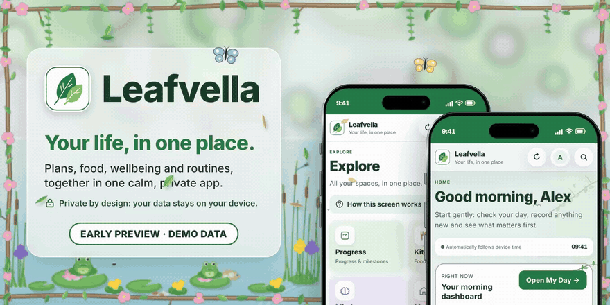
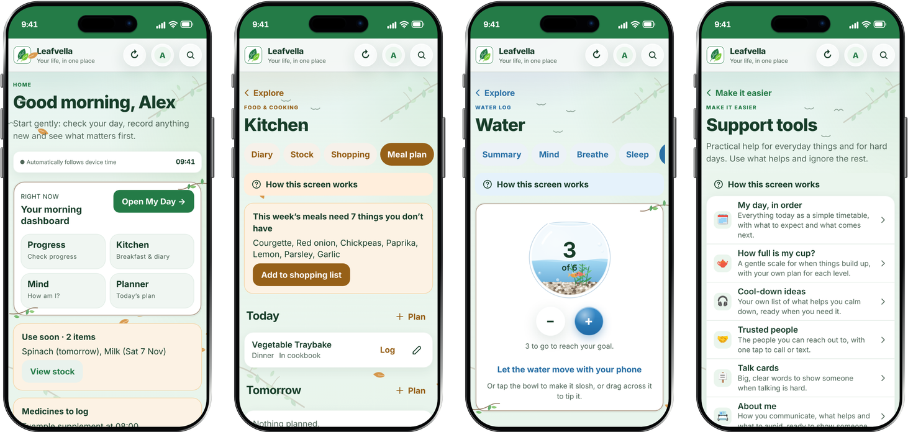

  
  
  
  
  
  

## Hi, I'm Dai 🌿

I'm a designer and creator at heart. I design how something should look and feel first, then build the system underneath it. It started with Lego, then Minecraft worlds, then my own GTA server. Now it's **Leafvella**.

> If I'm gonna do this, I'm gonna do it properly.

- 🔭 **Working on:** Leafvella, a calm, private app for everyday life
- 🎨 **My part:** product design, every screen, the standards, and testing on my own iPhone first
- 🌱 **Learning:** how a real iPhone app is built, step by step
- 🤝 **Building with:** Wolf, my co-founder and lead developer, who prefers to stay anonymous and codes the finished app
- 💬 **Ask me about:** accessible design, privacy-first apps, and designing visually first

---

### 🍃 Leafvella: your life, in one place

A calm, private iPhone app that brings your plans, food, wellbeing and everyday support together in one place. Everything stays on your phone.

| Space | What it does |
|---|---|
| 📅 **Planner** | Tasks, calendar, routines, timers and a week at a glance |
| 🍽️ **Kitchen** | Food diary, what you have in, shopping lists, meal plans, your own cookbook |
| 💚 **Wellbeing** | Log mood, sleep, water and medicines; a private journal; breathe |
| 🤲 **Support** | My day in order, how full is my cup, cool-down ideas, talk cards |
| ♿ **Make it easier** | Calm and predictable, easy reading, focus and memory help, bigger targets |
| 🌍 **14 languages** | Including Welsh, Arabic and Urdu, with proper right-to-left layouts |

🌐 **[leafvella.daibowie.workers.dev](https://leafvella.daibowie.workers.dev/)**

### Milestones

| When | What |
|---|---|
| October 2026 | The idea, and the first designs |
| 12 days later | A full working version on the web, every screen designed and tested |
| November 2026 | The design locked as the blueprint for the real app |
| Now | Wolf getting set up to code the real iPhone and iPad app |
| Next | Friends and family try it (UK, United States and Canada), then the App Store |
| Later | Android |

### How it's made

1. **I design it:** every screen, every word, and the standards it's held to.
2. **AI set it up:** the working demo, the blueprint and the testing tools, so it was possible to get this far, this fast.
3. **Wolf codes the real app:** the Leafvella you'll download is Wolf's app, coded from that blueprint step by step. In time, every part of the finished app will be her code.

### Built with

- **iPhone and iPad (coded by Wolf):** Swift and SwiftUI, Liquid Glass, Siri and Shortcuts
- **Web demo and website:** HTML, CSS and JavaScript, set up with AI, with no outside libraries, fonts or tracking
- **Hosting:** Cloudflare
- **Testing:** automated checks for every screen in light and dark (contrast, labels, tap sizes, text size), plus my own iPhone

---

### Why I made Leafvella

> I'm disabled, and I know how hard everyday things can be. Leafvella was built for me specifically, and shared to make the world that little bit easier for everyone else who battles day to day like I do.
>
> It's calm, private and patient. It never judges you for a hard day. If it helps you even a little, it's done what I hoped.

---

### How I build

- 🔒 **Private, above and beyond.** No accounts, no emails, no tracking, no adverts. Your information stays on your phone.
- 🤝 **Honest.** It logs, it never measures. No diagnoses, no fake reviews, and I say what's been checked and what hasn't.
- 💚 **Kind.** Built for someone on a hard day. No guilt, no judging.
- ♿ **For everyone.** Accessible from the very first screen, not added at the end.
- 🌱 **Open.** Leafvella will be open source under the Apache License 2.0.

[Our standards](https://leafvella.daibowie.workers.dev/standards.html) · [Privacy promise](https://leafvella.daibowie.workers.dev/privacy.html) · [Accessibility](https://leafvella.daibowie.workers.dev/accessibility.html) · [What's coming](https://leafvella.daibowie.workers.dev/coming.html) · [Press kit](https://leafvella.daibowie.workers.dev/press.html)

### Follow along

No mailing list and no sign-up, because privacy means privacy. Everything official is published openly:

- 📰 **[News](https://leafvella.daibowie.workers.dev/news.html)**, newest first
- 📡 **[News feed](https://leafvella.daibowie.workers.dev/feed.xml)** for any news reader app (it never tells me who you are)
- 🧭 **[What's coming](https://leafvella.daibowie.workers.dev/coming.html)**

---

Need help right now? Leafvella isn't an emergency service. In the UK call 999, or Samaritans on 116 123. In the US and Canada call 911, or 988.

Leafvella™ and the Leafvella leaf logo are trade marks of Leafvella.
